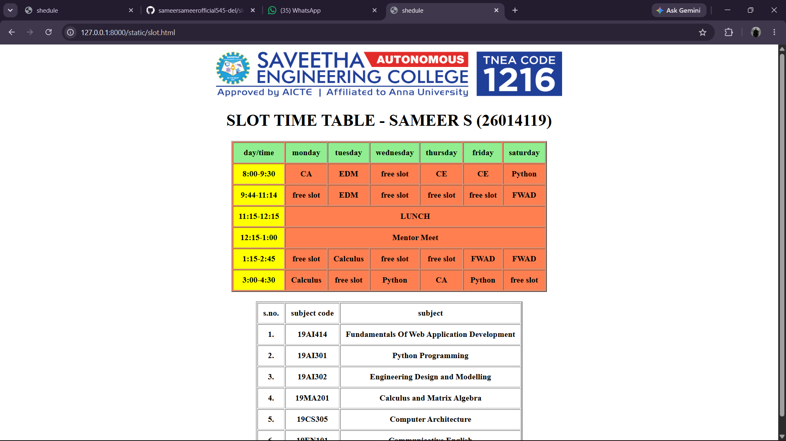

# Ex04 Time Table
## Date:21/11/2026

## AIM
To write a html webpage page to display your slot timetable.

## ALGORITHM
### STEP 1
Create a Django-admin Interface.

### STEP 2
Create an App inside the Django project.

### STEP 2
Create a static folder uder the created App and insert HTML code.

### STEP 3
Create a simple table using ```<table>``` tag in html with the relevant attributes.

### STEP 4
Add rows using ```<tr>``` tag.

### STEP 5
Add your course schedule using ```<td>``` tag.

### STEP 6
Execute the program using runserver command.

## PROGRAM
```
<html>
    <head>
        <title>shedule</title>
    </head>
    <body>
        <center>
        
        </center>
        <h1 align="center">SLOT TIME TABLE - SAMEER S (26014119)</h1>
        <table border="2" bgcolor="coral" align="center" cellpadding="10">

            <tr bgcolor="lightgreen">
                <th>day/time </th>
                <th>monday   </th>
                <th>tuesday  </th>
                <th>wednesday</th>
                <th>thursday </th>
                <th>friday   </th>
                <th>saturday </th>
            </tr>
            <tr>
                <th bgcolor="yellow">8:00-9:30</th>
                <th>CA</th>
                <th>EDM</th>
                <th>free slot</th>
                <th>CE</th>
                <th>CE</th>
                <th>Python</th>
            </tr>
            <tr>
                <th bgcolor="yellow">9:44-11:14</th>
                <th>free slot</th>
                <th>EDM</th>
                <th>free slot</th>
                <th>free slot</th>
                <th>free slot</th>
                <th>FWAD</th>
            </tr>
            <tr>
                <th bgcolor="yellow">11:15-12:15</th>
                <th colspan="6" align="center">LUNCH</th>
                
            <tr>
                <th bgcolor="yellow">12:15-1:00</th>
                <th colspan="6" align="center">Mentor Meet</th>
                
            </tr>
             <tr>
                <th bgcolor="yellow">1:15-2:45</th>
                <th>free slot</th>
                <th>Calculus</th>
                <th>free slot</th>
                <th>free slot</th>
                <th>FWAD</th>
                <th>FWAD</th>
            </tr>
             <tr>
                <th bgcolor="yellow">3:00-4:30</th>
                <th>Calculus</th>
                <th>free slot</th>
                <th>Python</th>
                <th>CA</th>
                <th>Python</th>
                <th>free slot</th>
            </tr>
        </table>
        <br>
        <table border="2" border-color="blue" align="center" cellpadding="10">
            <tr>
                <th>s.no.</th>
                <th>subject code</th>
                <th>subject</th>
            </tr>
             <tr>
                <th>1.</th>
                <th>19AI414</th>
                <th>Fundamentals Of Web Application Development</th>
            </tr>
             <tr>
                <th>2.</th>
                <th>19AI301</th>
                <th>Python Programming</th>
            </tr>
             <tr>
                <th>3.</th>
                <th>19AI302</th>
                <th>Engineering Design and Modelling</th>
            </tr>
             <tr>
                <th>4.</th>
                <th>19MA201</th>
                <th>Calculus and Matrix Algebra</th>
            </tr>
             <tr>
                <th>5.</th>
                <th>19CS305</th>
                <th>Computer Architecture</th>
            </tr>
             <tr>
                <th>6.</th>
                <th>19EN101</th>
                <th>Communicative English</th>
            </tr>
        </table>
    </body>
</html>

```


## OUTPUT



## RESULT
The program for creating slot timetable using basic HTML tags is executed successfully.
